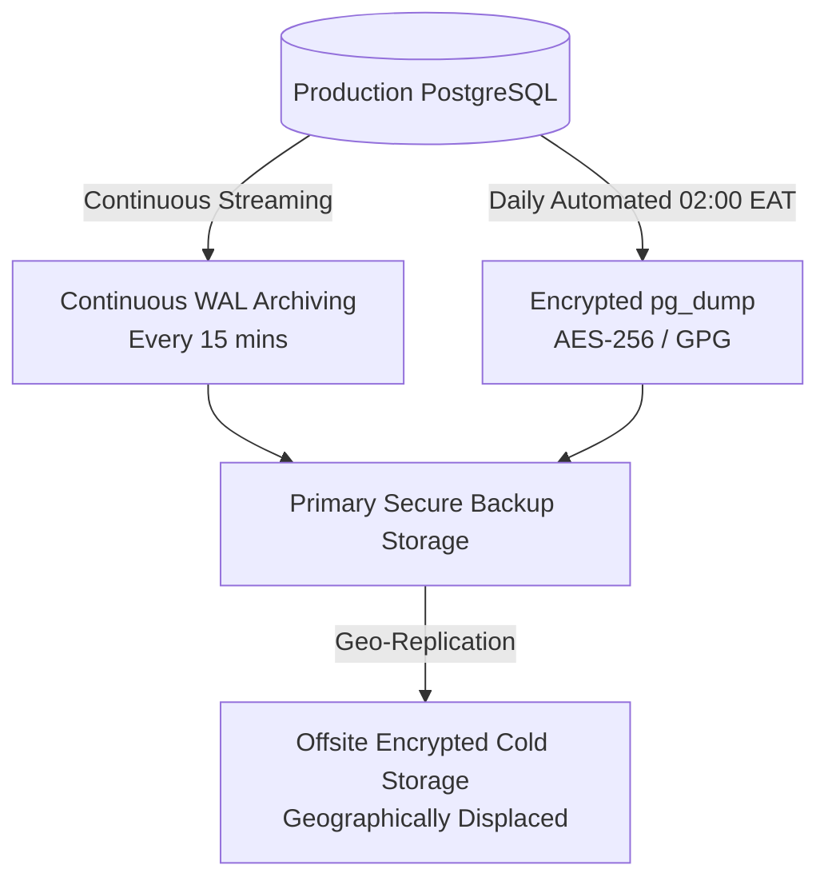

# Hospital HMIS Disaster Recovery & Business Continuity Plan

**Document Reference:** OPS-DRP-HMIS-2026-V1  
**Target Facility:** Level 4 / 5 / 6 Kenyan Hospital  
**System Evaluated:** Nexus Hospital Management Information System (HMIS)  
**Governing Standard:** ISO/IEC 27031 | Digital Health Regulations 2025 § 20  
**Effective Date:** October 2026  

---

## 1. Objectives & Service Level Targets

| Metric | Target SLA | Definition & Operational Impact |
|---|---|---|
| **Recovery Point Objective (RPO)** | **< 15 minutes** | Maximum allowable data loss in the event of hardware or datacenter catastrophe. Achieved via continuous Write-Ahead Log (WAL) streaming and 15-minute transactional log archiving. |
| **Recovery Time Objective (RTO)** | **< 60 minutes** | Maximum allowable duration to restore full clinical operations on secondary or recovered infrastructure. |
| **Data Retention Standard** | **20 Years** | Minimum legal retention period for clinical electronic health records under the Digital Health Regulations, 2025 § 22. |

---

## 2. Backup Architecture & Storage Tiers



### 2.1 Backup Strategy Details
1. **Continuous Write-Ahead Logging (WAL):**  
   PostgreSQL `archive_command` transmits completed WAL segments to encrypted backup storage every 15 minutes, allowing Point-in-Time Recovery (PITR) to within seconds of any hardware failure.
2. **Nightly Full Database Dumps:**  
   Automated `pg_dump -Fc` executed daily at 02:00 EAT. Files are immediately encrypted using AES-256 with keys stored independently of the database servers.
3. **Immutability & Retention Rules:**  
   Backup buckets enforce Object Lock (WORM - Write Once, Read Many) for 90 days. Backups cannot be deleted or modified even with root administrator credentials.

---

## 3. Disaster Recovery Drill Runbook (Step-by-Step)

Quarterly DR drills are mandatory to verify recovery procedures without impacting live hospital operations.

### Step 1: Provision Isolated Staging Environment
```powershell
# Create isolated recovery database target
createdb -h localhost -U postgres hmis_recovery_test
```

### Step 2: Download & Decrypt Latest Backup Image
```powershell
# Retrieve latest encrypted nightly backup
aws s3 cp s3://hospital-hmis-backups/daily/hmis_backup_latest.dump.gpg ./scratch/

# Decrypt backup using dedicated disaster recovery key
gpg --decrypt --output ./scratch/hmis_recovery.dump ./scratch/hmis_backup_latest.dump.gpg
```

### Step 3: Restore Schema and Data
```powershell
# Execute pg_restore into isolated database
pg_restore -h localhost -U postgres -d hmis_recovery_test --clean --if-exists --no-owner ./scratch/hmis_recovery.dump
```

### Step 4: Verification & Integrity Testing
Execute the automated post-recovery integrity suite:
1. **Row Count Verification:** Compare record counts across `patients`, `encounters`, `orders`, and `invoices`.
2. **Audit Hash-Chain Verification:** Run the cryptographic audit verification script to ensure all sequential hashes (`prev_hash` → `hash`) remain continuous and uncorrupted.
3. **Decryption Check:** Verify sample patient identifiers decrypt cleanly with the current field-encryption key.

```sql
-- Verify audit chain integrity on recovered instance
SELECT count(*) AS total_audit_rows,
       count(*) FILTER (WHERE hash IS NULL) AS unhashed_rows
FROM audit_log;
```

### Step 5: Clean-up and Certification
Drop the test database and generate the signed Quarterly DR Drill Report for the Medical Superintendent and DPO.

---

## 4. Emergency Failover Checklist

In the event of total datacenter loss or severe infrastructure failure:

- [ ] **T+00m:** Disaster declared by Incident Commander / Head of ICT. Activate Hospital Downtime Procedures (`docs/ops/downtime-procedures.md`).
- [ ] **T+10m:** Verify status of primary database host. Confirm failover to hot-standby or initiate automated PITR restore on secondary cloud host.
- [ ] **T+25m:** Apply latest verified WAL logs up to the moment of failure.
- [ ] **T+35m:** Verify database connection pool health (`DATABASE_URL_APP` / `DATABASE_URL_ADMIN`).
- [ ] **T+45m:** Update DNS records / routing to direct hospital traffic to recovered host.
- [ ] **T+50m:** Verify staff login, MFA, and access to patient search and consultation queues.
- [ ] **T+60m:** Declare system online. Initiate catch-up reconciliation protocol to enter downtime paper records into the recovered HMIS.
