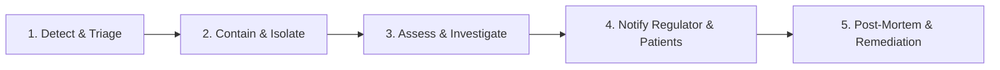

# Health Data Incident & Breach Response Plan

**Document Reference:** SEC-IRP-HMIS-2026-V1  
**Target Organization:** Level 4 / 5 / 6 Kenyan Hospital  
**System Evaluated:** Nexus Hospital Management Information System (HMIS)  
**Governing Authority:** Office of the Data Protection Commissioner (ODPC) | Digital Health Agency (DHA)  
**Effective Date:** October 2026  

---

## 1. Incident Response Lifecycle

In accordance with the Kenya Data Protection Act, 2019 (§ 43) and the Digital Health Act, 2023, all personal data breaches and security incidents follow a strict five-stage response workflow:



---

## 2. Severity Classification Matrix

| Severity Level | Definition & Clinical / Privacy Impact | Response SLA | Regulatory Reporting |
|---|---|---|---|
| **P1 - Critical** | Large-scale exfiltration of PHI, active ransomware encrypting database, compromise of database admin credentials, or widespread alteration of clinical notes threatening patient safety. | **Immediate (≤ 30 mins)** | Mandatory notification to ODPC and DHA within **72 hours**. |
| **P2 - High** | Unauthorised access to sensitive patient records (e.g. VIP/HIV/mental health records), compromised staff account with clinical or administrative scope, or failure of audit hash-chain integrity. | **≤ 2 hours** | Mandatory notification to ODPC if risk to patient rights exists. |
| **P3 - Medium** | Single user account locked due to suspicious credential stuffing, minor accidental disclosure of non-clinical demographic data to wrong patient, or transient failure of external HIE sync. | **≤ 8 hours** | Internal logging in `incident_register`; reportable if systemic. |
| **P4 - Low** | Benign policy violation (e.g. workstation left unlocked in private locked office), benign false positive audit alert, isolated client-side script error. | **≤ 24 hours** | Internal record only; no regulatory report required. |

---

## 3. Five-Stage Response Workflow

### Stage 1: Detection & Triage
- **Sources:** Automated audit anomaly detectors (mass record queries, off-hours access, hash chain failure), staff reports, patient inquiries, or external DHA notices.
- **Action:** Incident Commander and Data Protection Officer (DPO) are alerted. An entry is created in `incident_register`.

### Stage 2: Containment & Isolation
- **Technical Actions:**
  - Revoke affected user sessions via `lib/auth/sessions.ts` (`session:manage`).
  - Force immediate MFA and password reset for compromised credentials (`mfa:reset`).
  - Temporarily restrict external integration endpoints via module flags (`module:manage`).
  - Take forensically sound database snapshots and WAL archive copies for evidence preservation.

### Stage 3: Assessment & Forensic Investigation
- Verify whether Protected Health Information (PHI) was accessed, copied, or modified using the tamper-evident hash-chained `audit_log`.
- Determine the scope: number of patient records affected, nature of clinical data exposed, and risk of harm (identity theft, discrimination, reputational damage).

### Stage 4: Notification (Regulator & Data Subjects)

#### 4.1 Statutory Notification to ODPC (Within 72 Hours)
Under DPA 2019 § 43, the Data Controller must notify the Data Commissioner without undue delay and, where feasible, within **72 hours** of becoming aware of the breach.

#### 4.2 Notification to Affected Patients / Data Subjects
Where the breach is likely to result in a high risk to the rights and freedoms of the data subjects, the hospital must communicate the breach to the affected individuals directly without undue delay.

### Stage 5: Post-Mortem & Remediation
- Comprehensive root cause analysis (RCA) documented in `incident_register`.
- Technical safeguards patched, database migrations deployed if schema hardening is required.
- Formal report delivered to the Hospital Board and Medical Superintendent.

---

## 4. Statutory Notification Templates

### Template A: Notice of Personal Data Breach to the ODPC

```
TO:
Office of the Data Protection Commissioner (ODPC)
Nairobi, Kenya
Email: incident@odpc.go.ke / info@odpc.go.ke

FROM:
[Hospital Name] (Data Controller Registration No: [ODPC-REG-XXXXX])
Date: [YYYY-MM-DD HH:MM]

SUBJECT: FORMAL NOTIFICATION OF PERSONAL DATA BREACH (DPA 2019 § 43)

1. DETAILS OF DATA CONTROLLER:
   - Organization: [Hospital Name]
   - Facility MFL Code: [MFL Code]
   - Data Protection Officer (DPO): [Name, Email, Mobile]

2. NATURE AND CIRCUMSTANCES OF THE BREACH:
   - Date and Time Incident Occurred: [Timestamp]
   - Date and Time Incident Detected: [Timestamp]
   - Description: [Brief technical description of incident, e.g., credential compromise / unauthorized read]
   - Incident Reference: [INC-YYYY-XXXX]

3. CATEGORIES AND NUMBER OF DATA SUBJECTS:
   - Total Patients / Individuals Affected: [Approximate Number]
   - Categories of Personal Data Involved: [e.g., Names, National IDs, Clinical Diagnoses, Prescriptions]

4. LIKELY CONSEQUENCES AND RISK ASSESSMENT:
   - Potential impact on affected individuals: [e.g., potential unauthorized disclosure of medical history]

5. MEASURES TAKEN OR PROPOSED TO REMEDY THE BREACH:
   - Immediate containment actions taken: [e.g., sessions terminated, credentials rotated, IP blocked]
   - Forensic analysis conducted: [Audit log hash-chain verification, read-event tracing]
   - Corrective technical measures implemented: [Patch deployed, permissions revoked]

6. COMMUNICATION TO DATA SUBJECTS:
   - [ ] Data subjects have been notified directly on [Date]
   - [ ] Data subjects will be notified by [Date] via secure SMS / registered letter

Signed:
_______________________________
Data Protection Officer / Chief Executive Officer
```

---

### Template B: Notice of Personal Data Breach to Affected Patient

```
CONFIDENTIAL & PRIVILEGED

Dear [Patient Full Name],

RE: NOTICE CONCERNING THE SECURITY OF YOUR PERSONAL HEALTH DATA

We are writing to inform you of a recent data security incident at [Hospital Name] that may have involved some of your personal information recorded in our hospital system.

WHAT HAPPENED?
On [Date], our automated security monitoring detected [brief, plain-language description: e.g., an unauthorized attempt to access certain hospital system accounts]. Our security team contained the incident within [X minutes/hours].

WHAT INFORMATION WAS INVOLVED?
Our review indicates that the information that may have been accessed included:
- Your name, patient identification number, and contact details
- [If clinical data: Dates of attendance and consultation summaries]
[CONFIRMATION: Your financial payment credentials / M-Pesa PIN was NEVER stored in our system and was NOT compromised.]

WHAT ARE WE DOING?
We take the confidentiality of your medical information with the utmost gravity. Upon discovering this event, we immediately:
1. Blocked the unauthorized access point and terminated all relevant access credentials.
2. Verified the cryptographic integrity of all medical records.
3. Formally reported this matter to the Office of the Data Protection Commissioner (ODPC).
4. Implemented enhanced monitoring and security restrictions across all hospital terminals.

WHAT CAN YOU DO?
We recommend that you remain vigilant against any unsolicited phone calls or messages claiming to be from hospital staff or financial institutions requesting verification of your personal details.

FOR FURTHER INFORMATION:
If you have any questions or wish to discuss this matter, please contact our Hospital Data Protection Officer at:
- Phone: [DPO Direct Phone]
- Email: dpo@[hospital-domain].go.ke / .co.ke

Yours sincerely,

[Name]
Medical Superintendent / Data Protection Officer
[Hospital Name]
```

---

## 5. Incident Log Register Schema (`incident_register`)

All security and privacy incidents are immutably recorded in the database schema:

```sql
CREATE TABLE IF NOT EXISTS incident_register (
  id UUID PRIMARY KEY DEFAULT gen_random_uuid(),
  tenant_id UUID NOT NULL REFERENCES organizations(id),
  incident_number VARCHAR(50) NOT NULL UNIQUE,
  severity VARCHAR(20) NOT NULL CHECK (severity IN ('P1', 'P2', 'P3', 'P4')),
  category VARCHAR(50) NOT NULL,
  description TEXT NOT NULL,
  affected_patients_count INT DEFAULT 0,
  detected_at TIMESTAMPTZ NOT NULL,
  contained_at TIMESTAMPTZ,
  odpc_notified_at TIMESTAMPTZ,
  status VARCHAR(30) NOT NULL DEFAULT 'open',
  reported_by UUID NOT NULL REFERENCES users(id),
  assigned_dpo UUID REFERENCES users(id),
  root_cause TEXT,
  remediation_actions TEXT,
  created_at TIMESTAMPTZ NOT NULL DEFAULT NOW(),
  updated_at TIMESTAMPTZ NOT NULL DEFAULT NOW()
);
```
