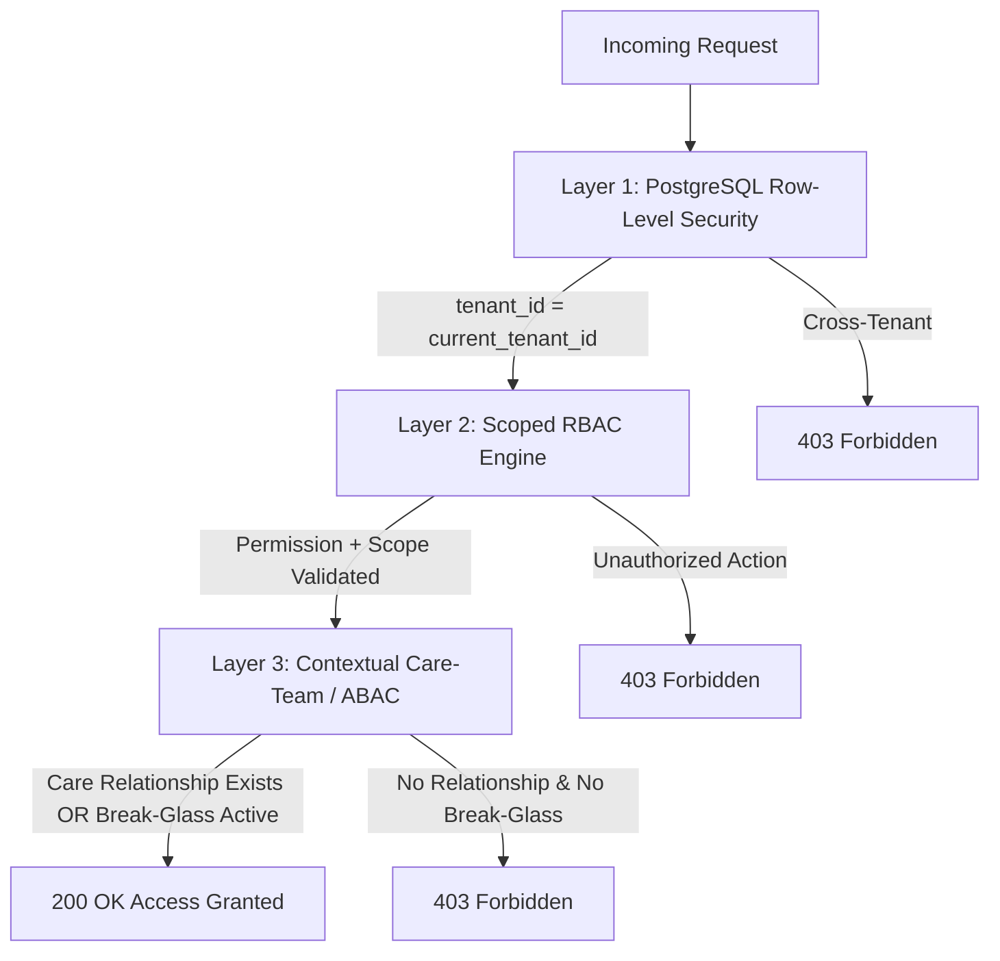

# Nexus HMIS Security Permission Matrix

**Document Reference:** SEC-PERM-MATRIX-2026-V1  
**Single Source of Truth:** `lib/authz/catalogue.ts`  
**Governing Standard:** Role-Based Access Control (RBAC) with Scopes + Contextual Care-Team Validation (ABAC)  
**Effective Date:** October 2026  

---

## 1. Multi-Layered Authorization Architecture

Authorization in the Nexus HMIS requires satisfying three consecutive, independent evaluation layers:

### 1.1 Layer 1: Multi-Tenant Database Isolation
Enforced at the PostgreSQL kernel level using Row-Level Security (`app.current_tenant_id`). The application database role `mis_app` operates with `NOBYPASSRLS`. No query can access rows belonging to another facility.

### 1.2 Layer 2: Scoped Role-Based Access Control (RBAC)
Every privilege is expressed as a `resource:action` atom (e.g. `clinical_note:create`, `lab_result:verify`) with an associated **Scope Hierarchy**:
- **`own`**: Access restricted strictly to records created by or directly assigned to the authenticated user.
- **`assigned`**: Access restricted to patients/records where the user is formally assigned (e.g., active care-team member or named ordering clinician).
- **`department`**: Access permitted across all records within the user's active department.
- **`hospital`**: Facility-wide administrative or oversight access.

### 1.3 Layer 3: Contextual Care-Team Verification (ABAC)
For clinical and sensitive diagnostic records, holding a permission is insufficient. The user must also satisfy an active care-team check:
- Named attending clinician, consulting doctor, or triage nurse on the patient's active encounter.
- Named ordering or performing clinician for active diagnostic/pharmacy orders.
- Or holding an active, time-limited **Emergency Break-Glass Grant**.

---

## 2. Comprehensive System Role × Module Permission Matrix

| System Role | Category / Module Scope | Key Granted Permissions (`codename:scope`) | Strictly Denied Actions & Boundary Protections |
|---|---|---|---|
| **System Owner** | System Infrastructure & Integrations | `module:manage:hospital` `integration:manage:hospital` `integration:read:hospital` | **Zero PHI Access.** Cannot view patients, clinical notes, lab results, prescriptions, or billing ledgers. |
| **Hospital Administrator** | Organization, Staff, Security & Operations | `hospital:manage:hospital` `department:manage:hospital` `department_member:manage:hospital` `staff:create/read/update/deactivate:hospital` `role:manage/assign:hospital` `mfa:reset:hospital` `session:manage:hospital` `module:manage:hospital` `price_list:manage:hospital` `audit:read:hospital` | **No Clinical Notes or Diagnoses.** Cannot view clinical consultation notes or diagnostic reports without break-glass. Cannot delete audit logs. |
| **Clinical Director** | Hospital-Wide Clinical Governance & Oversight | `patient:read:hospital` `encounter:read:hospital` `clinical_note:read:hospital` `diagnosis:read:hospital` `lab_result:read:hospital` `imaging_report:read:hospital` `break_glass:review:hospital` `access_review:read:hospital` `audit:read:hospital` `report:read:hospital` | Cannot modify or create financial tariffs, manage system modules, or dispense medications. Oversight and clinical review role. |
| **Department Head** | Departmental Staff, Rostering & Workload | `department:read/update:department` `department_member:manage:department` `staff:read:department` `roster:read/manage:department` `requisition:approve:department` `audit:read:department` `report:read:department` | Strictly bounded to own department. Cannot view patients or staff of other departments without clinical assignment. |
| **Doctor / Clinical Officer** | Outpatient & Inpatient Clinical Care | `patient:read:assigned` `encounter:create:department` `encounter:read:assigned` `encounter:update:own` `clinical_note:create:department` `clinical_note:read:assigned` `clinical_note:amend:own` `diagnosis:create:department` `diagnosis:read:assigned` `allergy:create/read:hospital` `order:create:department` `order:read:assigned` `order:cancel/ack:own` `lab_result:read:assigned` `imaging_report:read:assigned` `admission:create/discharge:department` `theatre_case:create/read/update:department` `break_glass:request:hospital` | Cannot modify price lists, settle cash invoices, verify laboratory analyzer runs, or dispense pharmacy stock directly. |
| **Nurse / Midwife** | Triage, Inpatient Care, Nursing Notes & MAR | `patient:read:assigned` `encounter:read:assigned` `triage:create/read:department` `vitals:create:department` `vitals:read:assigned` `allergy:read:hospital` `nursing_note:create/read:department` `mar:administer/read:department` `bed:manage:department` `clinical_note:read:assigned` `order:read:assigned` `break_glass:request:hospital` | Cannot sign off final medical discharge summaries, prescribe controlled drugs, or create financial invoices. |
| **Pharmacist** | Prescription Review, Dispensing, Stock & Formularies | `patient:read:assigned` `prescription:read/dispense:department` `stock:read/manage:department` `formulary:manage:hospital` `controlled_drug:manage:department` `allergy:read:hospital` `diagnosis:read:assigned` | Cannot author clinical encounter notes, place surgical theatre bookings, or adjust hospital service prices. |
| **Lab Technologist** | Specimen Collection, Analysis & Verification | `lab_sample:create:department` `lab_result:create/read/verify:department` `order:read:department` `patient:read:assigned` | Cannot view general consultation notes, nursing notes, or financial invoices. Sees order clinical reason only. |
| **Radiologist / Radiographer** | Imaging Acquisition, Reporting & PACS | `imaging_order:read:department` `imaging_report:create/read:department` `order:read:department` `patient:read:assigned` | Bounded to radiology imaging orders and diagnostic interpretations. |
| **Registration / Front Desk** | Master Patient Index (MPI), Queues & Appointments | `patient:create/read/update:hospital` `consent:create/read:hospital` `appointment:create/read/update:hospital` `coverage:read:hospital` `triage:read:department` | **Zero Clinical Content.** Prohibited from viewing clinical notes, diagnoses, lab results, or imaging reports. |
| **Cashier / Billing Officer** | Invoices, Cash/M-Pesa Collections & Shifts | `patient:read:hospital` `invoice:create/read:hospital` `payment:create/read:hospital` `waiver:create:hospital` `cashier_shift:manage:hospital` `coverage:read:hospital` | Prohibited from viewing clinical notes, prescriptions, or triage notes. May only view chargeable line items. |
| **Claims Officer** | Insurance Eligibility, Pre-Auth & SHA Claims | `patient:read:hospital` `coverage:read/manage:hospital` `claim:create/read/submit:hospital` `preauth:create/read:hospital` `invoice:read:hospital` `diagnosis:read:hospital` | Access restricted to diagnosis codes and service items required for claim assembly. No access to full narrative notes. |
| **Health Records Officer (HIM)** | ICD-11 Coding, Completeness & Release | `patient:read:hospital` `encounter:read:hospital` `clinical_note:read:hospital` `diagnosis:read/create:hospital` `him:manage:hospital` `amendment:create/approve:hospital` | Cannot dispense medications, prescribe, or collect patient cash. |
| **Store / Inventory Officer** | General Stores, Requisitions & Procurement | `inventory:read/manage:hospital` `requisition:create/approve:hospital` | **Zero Patient Data Access.** Prohibited from reading patient records, clinical notes, or financial bills. |
| **HR / Admin Officer** | Staff Profiles, Rosters, Leave & Licences | `hr:manage:hospital` `staff:read/update:hospital` `roster:read/manage:hospital` | **Zero Patient Data Access.** Cannot view patient charts or clinical records. |
| **Compliance / DPO / Auditor** | Audit Trail, Consent & Data Subject Requests | `audit:read/export:hospital` `access_review:read:hospital` `break_glass:review:hospital` `consent:read:hospital` `data_subject:manage:hospital` | **No Clinical Notes by Default.** Inspects access logs, metadata, and consent records. Full clinical access blocked. |
| **IT Support** | Account Resets, Session Termination & Status | `integration:read:hospital` `mfa:reset:hospital` `session:manage:hospital` `staff:read:hospital` | **Zero PHI Access.** Prohibited from viewing patient demographics, clinical notes, lab results, or financial transactions. |

---

## 3. Administrative Safeguards and Rules

1. **Privilege Escalation Prevention Rule:**  
   No user may grant or assign a permission codename or scope that they do not personally possess.
2. **Two-Person Approval Rule for Administrator Elevation:**  
   Modifying any user account with `hospital_admin` role or assigning administrative permissions requires explicit confirmation by a second active administrator.
3. **Last Administrator Safeguard:**  
   The system blocks deactivating or revoking administrative roles if fewer than two active administrators remain.
4. **Self-Modification Block:**  
   Administrators cannot modify their own role assignments or approve their own discount waivers.
