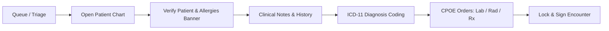

# Clinician & Medical Officer Operating Guide

**Document Reference:** TRN-CLIN-HMIS-2026-V1  
**Target Roles:** Medical Officers, Clinical Officers, Medical Specialists, Consultants  
**Modules Covered:** OPD Clinical Documentation, ICD-11 Diagnosis Coding, Orders (CPOE), Care-Team, Break-Glass  
**System:** Nexus Hospital Management Information System (HMIS)  
**Effective Date:** October 2026  

---

## 1. Quick-Start Workflow (Patient Care Journey)

---

## 2. Step-by-Step Instructions

### 2.1 Accessing the Outpatient Clinic Queue
1. Log into the HMIS using your hospital email, password, and 6-digit TOTP code (Authenticator app).
2. Navigate to **OPD / Clinics** from the primary navigation bar.
3. Select your assigned clinical department (e.g., *General Outpatient Clinic*, *Pediatric Clinic*, *Surgical Clinic*).
4. View the real-time patient queue sorted by triage priority (Red / Amber / Yellow / Green).
5. Click **Call Patient** or select the patient's name to initiate the encounter.

### 2.2 Patient Safety Banner & Identity Verification
Always check the persistent top banner before proceeding with examination or documentation:
- **Two-Identifier Rule:** Verify patient's Full Name and Date of Birth / National ID with the patient.
- **Allergy Alert Banner:** Active drug and food allergies are highlighted in prominent red badges (e.g. `⚠️ Penicillin - Anaphylaxis`).
- **Vital Signs Summary:** Recent triage vitals (Blood pressure, Pulse, Temperature, SpO2) and triage priority score are visible immediately in the header.

### 2.3 Documenting Clinical Encounters
1. In the **Clinical Notes** panel, record structured observations:
   - **Chief Complaints & History of Presenting Illness (HPI)**
   - **Physical Examination Findings**
   - **Systemic Review**
2. **Auto-Save & Idle Lock:** The system continuously preserves draft notes locally in secure memory. If your terminal locks due to inactivity, re-entering your password restores your unsaved notes instantly without loss.

### 2.4 ICD-11 Diagnosis Search and Coding
Under Kenyan Ministry of Health standards and SHA claims guidelines, all primary diagnoses must be coded using **ICD-11**:
1. In the **Diagnoses** panel, begin typing the clinical condition name or keyword (e.g. *malaria*, *hypertension*, *gastroenteritis*).
2. The search engine dynamically retrieves official ICD-11 codes and descriptions (e.g. `1F40 - Malaria caused by Plasmodium falciparum`).
3. Select whether the diagnosis is **Primary** or **Secondary / Comorbidity**.
4. Click **Add Diagnosis**.

### 2.5 Computerized Provider Order Entry (CPOE)
Place all diagnostic and therapeutic orders directly within the patient encounter:
- **Laboratory Orders:** Select required investigations (e.g., *Full Blood Count*, *Urinalysis*, *Malaria RDT*). Enter clinical indication notes for the technologist.
- **Radiology Orders:** Request X-Rays, Ultrasound, or CT scans.
- **Prescriptions:** Search the hospital formulary. Specify dosage, route, frequency, and duration.
  - *Safety Guard:* If you prescribe a drug with a recorded allergy match, an override warning modal appears requiring you to document a clinical override reason.
- Click **Submit Orders**. Orders are instantly routed to the respective departmental worklists.

### 2.6 Signing and Locking Notes
- Once consultation is complete, click **Sign & Lock Encounter**.
- **Immutability Notice:** Signed clinical notes cannot be edited or deleted. If additional information arises later, use the **Addendum / Amendment** button to append a timestamped addendum.

---

## 3. Emergency Break-Glass Access Protocol

If you are treating an emergency patient outside your usual department or care team and need immediate access to their medical history:
1. When prompted with the access restriction screen, click **Request Emergency Break-Glass Access**.
2. Select the clinical emergency reason (e.g., *Acute Emergency Resuscitation*, *Critical Consultation*, *Out-of-Hours Covering Doctor*).
3. Enter a brief clinical justification note.
4. Click **Activate Emergency Access**.
5. The full patient chart is immediately unlocked for a 4-hour window. An amber notification banner will indicate an active break-glass session.
6. The Hospital Clinical Director and Data Protection Officer (DPO) receive an immediate audit alert for post-hoc clinical governance review.
