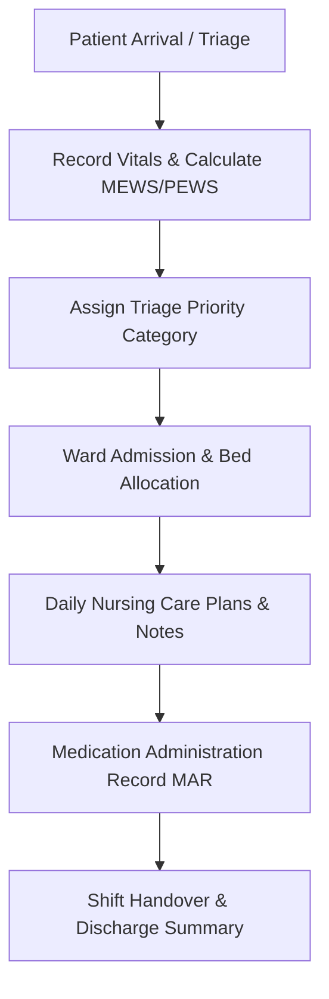

# Nursing & Inpatient Care Operating Guide

**Document Reference:** TRN-NURS-HMIS-2026-V1  
**Target Roles:** Registered Nurses, Midwives, Ward In-Charges, Triage Officers  
**Modules Covered:** Triage, Vitals & Early Warning Scores, Ward & Bed Management, Inpatient Notes, MAR  
**System:** Nexus Hospital Management Information System (HMIS)  
**Effective Date:** October 2026  

---

## 1. Quick-Start Workflow (Nursing Duties)

---

## 2. Step-by-Step Instructions

### 2.1 Outpatient Triage & Vitals Recording
1. Navigate to **Triage & Queue** from the main navigation menu.
2. Search for the patient by Name, National ID, or Clinic Queue Ticket.
3. Open the **Triage Assessment** screen and record baseline physiological observations:
   - **Body Temperature (°C)**
   - **Blood Pressure (Systolic / Diastolic mmHg)**
   - **Heart Rate / Pulse (beats per minute)**
   - **Respiratory Rate (breaths per minute)**
   - **Oxygen Saturation (SpO2 %)**
   - **Weight (kg) and Height (cm)** (Auto-calculates BMI and pediatric percentiles)
4. **Early Warning Scores (MEWS / PEWS):** The system automatically computes the Early Warning Score based on recorded physiological parameters.
5. **Assign Triage Category:**
   - 🔴 **Red (Immediate / Resuscitation):** Life-threatening conditions. Automatically escalates patient to the top of the Casualty/Doctor queue with audio-visual alerts.
   - 🟠 **Amber (Very Urgent):** Severe pain, high fever, chest distress.
   - 🟡 **Yellow (Urgent):** Moderate symptoms, stable vitals.
   - 🟢 **Green (Non-Urgent):** Routine complaints, normal vitals.
6. Click **Save Triage**. Patient is routed directly to the designated consultation room queue.

### 2.2 Ward Bed Management & Patient Admission
1. Navigate to **Inpatient / Wards**.
2. Select your ward (e.g., *Female Medical Ward*, *Pediatric Ward*, *Maternity Ward*).
3. **Bed Layout Visualizer:** The screen displays an interactive floor plan of beds:
   - 🟩 **Green Bed:** Available / Sanitized.
   - 🟥 **Red Bed:** Occupied.
   - 🟨 **Yellow Bed:** Reserved / Pending cleaning.
4. To admit a patient from OPD or Casualty:
   - Click **Admit Patient**, select the patient from the pending admission queue, choose an available bed, and click **Confirm Bed Assignment**.
5. **Bed Transfers:** To transfer a patient to another bed or ward (e.g. step-down from ICU to General Ward), click on the patient's current bed, select **Transfer Bed**, choose the destination ward and bed number, and submit.

### 2.3 Medication Administration Record (MAR)
The Medication Administration Record (MAR) is the legal record of all drugs administered to inpatients:
1. Open the patient chart and navigate to the **MAR** tab.
2. Active medication orders prescribed by medical officers appear chronologically with scheduled administration times.
3. When administering a scheduled dose:
   - **Verify 5 Rights of Medication Administration:** Right Patient, Right Drug, Right Dose, Right Route, Right Time.
   - Click on the pending medication dose box.
   - Select status: **Given**, **Refused**, or **Withheld**.
   - If *Withheld* or *Refused*, enter the clinical reason (e.g. *patient vomiting*, *blood pressure too low*, *patient sleeping*).
   - Sign with your nurse credentials and click **Confirm Administration**.
4. The administration timestamp and administering nurse's name are immutably logged into the clinical audit trail.

### 2.4 Nursing Notes & Care Plans
- Record shift observations, wound dressing progress, drainage volumes, and nursing care plans under **Nursing Notes**.
- Notes are timestamped and signed with your professional cadre (e.g., *Jane Wanjiku, KRCHN*).

### 2.5 Shift Handover Summary
At the conclusion of each nursing shift:
1. Access the **Ward Handover Report** tab.
2. Review the list of all currently admitted patients, abnormal vitals alerts, pending laboratory results, and scheduled midnight IV infusions.
3. Both incoming and outgoing nurse shift leaders sign off on the electronic shift roster.
